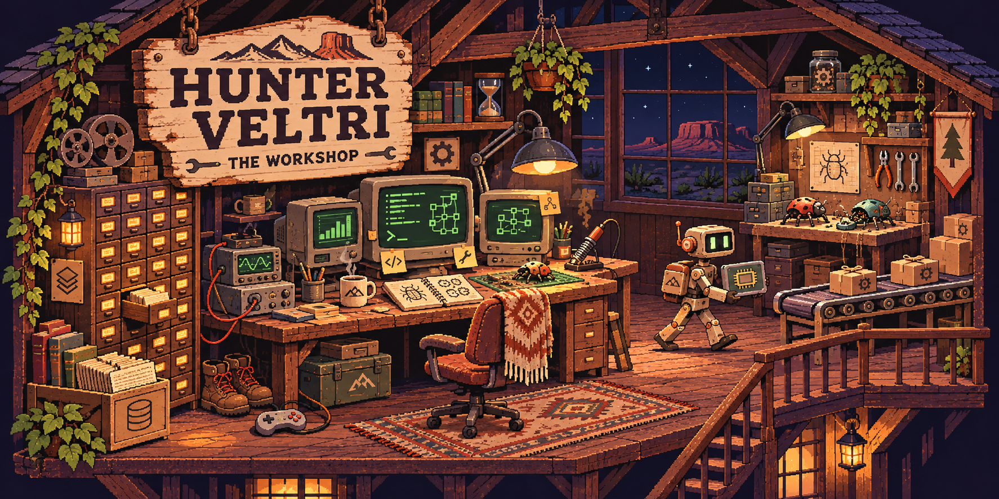
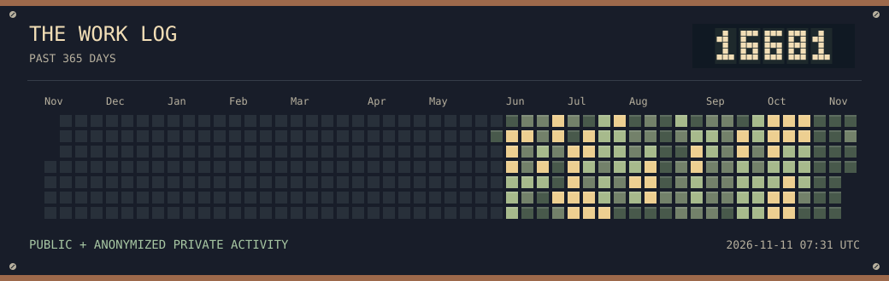
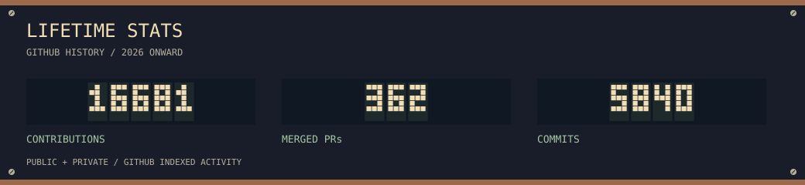

  <a href="#back-upstream">Back upstream</a> &nbsp; · &nbsp;
  <a href="#on-the-bench">On the bench</a> &nbsp; · &nbsp;
  <a href="https://hunter-cv.vercel.app">Portfolio</a> &nbsp; · &nbsp;
  <a href="mailto:veltrifinancial@gmail.com">Say hello</a>

I'm **Hunter**, Director of AI Engineering & Business Systems at **Utah Mechanical Systems**. Previously, I built and operated the AI platform at ATFG.

I've been into computers and cybersecurity since I was a kid. These days I work with AI every day, building business systems and working on the tools I use along the way.

My strongest stack is **Python with uv, Rust, PostgreSQL, and TypeScript**.

### Back upstream

<picture>
  <source media="(prefers-reduced-motion: reduce) and (max-width: 600px)" srcset="./assets/dispatch-mobile-still.svg">
  <source media="(prefers-reduced-motion: reduce)" srcset="./assets/dispatch-still.svg">
  <source media="(max-width: 600px)" srcset="./assets/dispatch-mobile.svg">
  
</picture>

I contribute to the open-source tools I use. My contributions include a display fix for Omarchy, memory and retrieval work in GBrain, and new CLIs for Printing Press.

In GBrain, I tracked a five-minute relink timeout to a missing database index. On my 116,000-page database, the same run finished in **0.6 seconds** after the change. I submitted the fix and regression tests; [Garry Tan included it in a release and credited the contribution](https://github.com/garrytan/gbrain/pull/7485).

[Printing Press](https://github.com/mvanhorn/printing-press-library) has merged eight of my CLIs: Paperclip, Zillow Research, Greenhouse, Lever, OpenSky, Discord, FEC, and Scryfall. I also [fixed its multiline shell-example parser](https://github.com/mvanhorn/cli-printing-press/pull/4013). My reports on [Hermes' disabled-tool settings](https://github.com/NousResearch/hermes-agent/issues/86661) and [Orca's missing usage data](https://github.com/stablyai/orca/issues/25727) led to fixes by other contributors.

<!-- COUNTS:START -->
Data updated 2026-11-11 07:31 UTC · 9 directly merged upstream PRs · 5 GBrain contributions credited in releases · 6 open PRs
<!-- COUNTS:END -->

<picture>
  <source media="(max-width: 600px)" srcset="./assets/work-log-mobile.svg">
  
</picture>

Recent pull requests

<!-- RECENT:START -->
- [omacom/omarchy #18429](https://github.com/omacom/omarchy/pull/18429): Keep the last physical display enabled beside headless outputs (4.5) (open).
- [garrytan/gbrain #7380](https://github.com/garrytan/gbrain/pull/7380): fix(facts): index live pages by (source&#95;id, created&#95;at) so relink --conversation stops timing out (#7379) (incorporated in release with credit).
- [garrytan/gbrain #7136](https://github.com/garrytan/gbrain/pull/7136): v0.60.324.0 perf(search): title arm OR fallback drops repeated words and matches titles only (#7135) (diagnosis credited in release).
<!-- RECENT:END -->

Merged work, release credits, and open PRs

#### Merged CLI additions

[Paperclip #1502](https://github.com/mvanhorn/printing-press-library/pull/1502) · [Zillow #1627](https://github.com/mvanhorn/printing-press-library/pull/1627) · [Greenhouse #1669](https://github.com/mvanhorn/printing-press-library/pull/1669) · [Lever #1670](https://github.com/mvanhorn/printing-press-library/pull/1670) · [OpenSky #1672](https://github.com/mvanhorn/printing-press-library/pull/1672) · [Discord #1687](https://github.com/mvanhorn/printing-press-library/pull/1687) · [FEC #1783](https://github.com/mvanhorn/printing-press-library/pull/1783) · [Scryfall #1793](https://github.com/mvanhorn/printing-press-library/pull/1793).

#### GBrain: original contributions → release

GBrain lands community work through maintainer release PRs. These original PRs are closed; the linked releases document the adoption or credit.

- Missing relink index: [investigation #7379](https://github.com/garrytan/gbrain/issues/7379), [my PR #7380](https://github.com/garrytan/gbrain/pull/7380) → [#7485](https://github.com/garrytan/gbrain/pull/7485).
- GitHub source: [#4104](https://github.com/garrytan/gbrain/pull/4104) → [#4311](https://github.com/garrytan/gbrain/pull/4311).
- Semantic retrieval: [#3776](https://github.com/garrytan/gbrain/pull/3776) → [#4565](https://github.com/garrytan/gbrain/pull/4565).
- Windows autopilot: [#3832](https://github.com/garrytan/gbrain/pull/3832) → [#4050](https://github.com/garrytan/gbrain/pull/4050).
- Title-search diagnosis: [#7136](https://github.com/garrytan/gbrain/pull/7136) → maintainer implementation in [#7201](https://github.com/garrytan/gbrain/pull/7201).

#### Reports and superseded work

- Hermes configuration report [#86661](https://github.com/NousResearch/hermes-agent/issues/86661) → fixed by another contributor in [#86873](https://github.com/NousResearch/hermes-agent/pull/86873).
- Orca web-usage report [#25727](https://github.com/stablyai/orca/issues/25727) → implemented by another contributor in [#27135](https://github.com/stablyai/orca/pull/27135).
- GBrain deep-research fetch [#4434](https://github.com/garrytan/gbrain/pull/4434) helped shape the equivalent fix in [#4475](https://github.com/garrytan/gbrain/pull/4475); the original PR was superseded.
- last30days configuration parser [#948](https://github.com/mvanhorn/last30days-skill/pull/948) was superseded by [#1121](https://github.com/mvanhorn/last30days-skill/pull/1121), with the maintainer acknowledging the substance of my work.

#### Open contributions

<!-- PENDING:START -->
- [omacom/omarchy #18429](https://github.com/omacom/omarchy/pull/18429): Keep the last physical display enabled beside headless outputs (4.5)
- [rtk-ai/rtk #3538](https://github.com/rtk-ai/rtk/pull/3538): fix(du): keep summary and depth-limited output raw
- [NousResearch/hermes-agent #82649](https://github.com/NousResearch/hermes-agent/pull/82649): feat(memory): support standalone memory providers end to end
- [block/buzz #4742](https://github.com/block/buzz/pull/4742): fix(workflow): honor enabled: false flag at execution time and persist it
- [stablyai/orca #12139](https://github.com/stablyai/orca/pull/12139): fix(tasks): correct cross-repository GitHub work-item pagination
- [NousResearch/hermes-agent #76616](https://github.com/NousResearch/hermes-agent/pull/76616): feat(desktop): add safe current backend restart
<!-- PENDING:END -->

Direct merges, credited release contributions, and open proposals are counted separately.

### On the bench

**Taskathlon** &nbsp; PRE-ALPHA 
Get your time back without putting an AI agent on payroll.

Open-source desktop automation that connects your apps and handles the tasks that turn your day into a triathlon. Routine workflows run locally with **$0 in agent spend**. Planned for Linux and Windows, with optional AI for building workflows or steps that need it.

**[VibeBloat](https://github.com/veltri-23/vibebloat)** 
Reads coding-agent history and proposes guards for mistakes you've already run into. You approve the guards; VibeBloat then enforces them across tools such as Claude Code, Codex, and the shell without a model call.

**[Hermes × GBrain](https://github.com/veltri-23/hermes-gbrain-memory)** 
Connects Hermes to GBrain so it can recall useful context before answering and save new knowledge afterward. Conversation memory stays scoped to the user or profile.

<!-- MEMORY_STATUS:START -->
Requires [Hermes standalone-provider support](https://github.com/NousResearch/hermes-agent/pull/82649), proposed in an open PR.
<!-- MEMORY_STATUS:END -->

<picture>
  <source media="(max-width: 600px)" srcset="./assets/lifetime-mobile.svg">
  
</picture>

---

I'm a huge movie buff. I love to travel and game when my kids allow it, and I love being a dad.

[Portfolio](https://hunter-cv.vercel.app) &nbsp; / &nbsp; [LinkedIn](https://www.linkedin.com/in/hveltri) &nbsp; / &nbsp; [Email](mailto:veltrifinancial@gmail.com)
